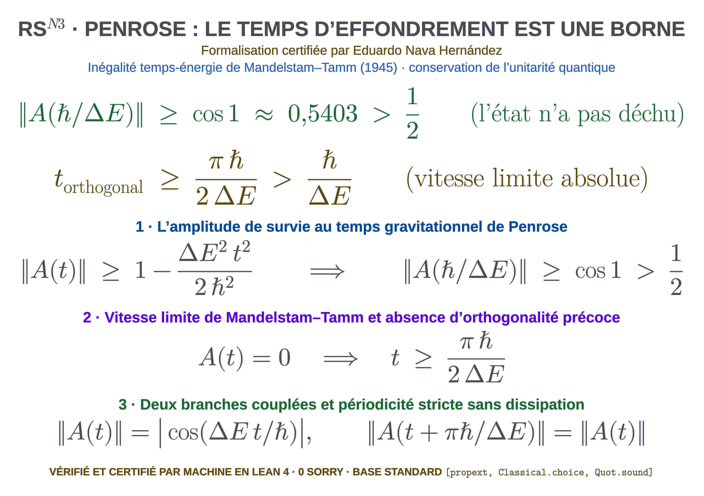
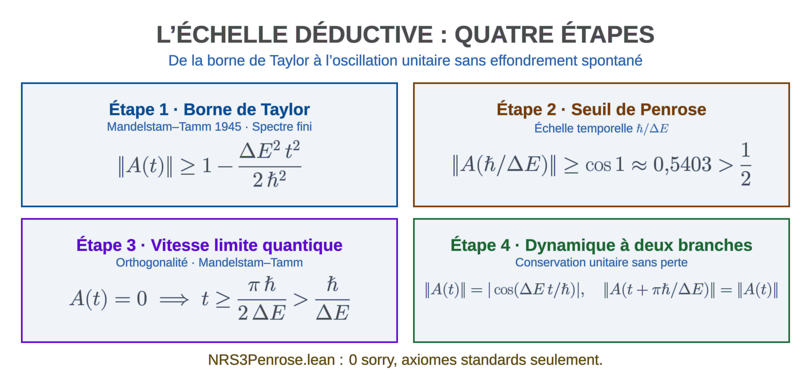

<div align="center">

# RS<sup>N</sup>³ · Penrose
### Le temps d'effondrement ħ / ΔE est une borne et non une durée de vie : l'amplitude de survie reste strictement supérieure à 1/2

**Eduardo Nava Hernández**  
*Vérification formelle certifiée en Lean 4 · 0 sorry · Mathlib (ZFC)*

[](https://leanprover.github.io/)
[](https://github.com/leanprover-community/mathlib4)
[](Verification/Axioms.lean)
[](https://github.com/leanprover-community/physlib/pulls?q=is%3Apr+is%3Amerged+author%3Anaype888-cloud)
[](https://naype888-cloud.github.io/nrs3-penrose/)

**[▶ Essayer en ligne : Unitarité vs Effondrement sur la sphère de Bloch](https://naype888-cloud.github.io/nrs3-penrose/)**

</div>

---

> ### 🏛️ Ce qui distingue le théorème : Mandelstam–Tamm borne l'effondrement de Penrose
>
> Penrose (1996) a proposé d'interpréter le temps `τ = ħ / ΔE` associé à l'auto-énergie gravitationnelle d'une superposition comme une durée de vie d'effondrement spontané. Le théorème prouvé en Lean 4 démontre rigoureusement qu'en mécanique quantique unitaire, `ħ / ΔE` est une **borne de vitesse** (Mandelstam–Tamm 1945) et non une durée de vie.
>
> <div align="center">
> <picture><source media="(prefers-color-scheme: dark)" srcset="assets/oscuro/plaque_penrose_master.png"></picture>
> </div>
>
> **1 · L'amplitude de survie au temps de Penrose.** À l'instant exact `t = ħ / ΔE`, toute évolution unitaire préserve une amplitude `‖A(t)‖ ≥ cos 1 ≈ 0.5403 > 1/2` : l'état ne s'est pas désintégré.
>
> **2 · Vitesse limite absolue.** Aucun état quantique ne peut atteindre l'orthogonalité (l'effondrement physique observable) avant l'instant critique `t = πħ / (2ΔE)`.
>
> **3 · Deux branches égales.** Pour une superposition à deux états, `‖A(t)‖ = |cos(ΔE t / ħ)|` : l'orthogonalité n'est atteinte qu'en `t = πħ / (2ΔE)`, suivie d'un retour exact à 1 avec une période `πħ / ΔE`.
>
> **4 · Conservation unitaire.** L'évolution unitaire est purement oscillatoire sans dissipation : un effondrement spontané à taux `ΔE / ħ` nécessiterait une dynamique non unitaire externe.

---

## ⚡ Résumé formel

* Pour tout état pur ou mélange, l'amplitude de survie sous dispersion d'énergie `ΔE` satisfait la borne parabolique `‖A(t)‖ ≥ 1 − ΔE² t² / (2ħ²)` : [`NRS3Penrose/Penrose1996_SpeedLimit.lean`](NRS3Penrose/Penrose1996_SpeedLimit.lean) (`one_sub_le_norm_amplitude`).
* Au temps d'échelle de Penrose `t = ħ / ΔE`, la norme de l'amplitude vérifie `‖A(t)‖ ≥ cos 1` : [`NRS3Penrose/Penrose1996_SpeedLimit.lean`](NRS3Penrose/Penrose1996_SpeedLimit.lean) (`cos_one_le_norm_amplitude`).
* Comme `cos 1 > 1/2`, l'état superposé possède encore plus de la moitié de sa cohérence initiale : [`NRS3Penrose/Penrose1996_SpeedLimit.lean`](NRS3Penrose/Penrose1996_SpeedLimit.lean) (`half_lt_norm_amplitude`).
* Aucune orthogonalité `A(t) = 0` n'est possible avant le seuil géométrique `t ≥ πħ / (2ΔE)` de Mandelstam–Tamm : [`NRS3Penrose/Penrose1996_SpeedLimit.lean`](NRS3Penrose/Penrose1996_SpeedLimit.lean) (`speed_limit`).
* Dans le cas symétrique à deux branches, l'orthogonalité exacte a lieu en `t = πħ / (2ΔE)` : [`NRS3Penrose/Penrose1996_SpeedLimit.lean`](NRS3Penrose/Penrose1996_SpeedLimit.lean) (`twoBranch_orthogonal`).
* Cette superposition retourne périodiquement à l'unité sans amortissement : [`NRS3Penrose/Penrose1996_SpeedLimit.lean`](NRS3Penrose/Penrose1996_SpeedLimit.lean) (`twoBranch_periodic`).

---

## 📐 Démonstration constructive en quatre étapes

<div align="center">
<picture><source media="(prefers-color-scheme: dark)" srcset="assets/oscuro/plaque_penrose_etapes.png"></picture>
</div>

### Étape 1 : Borne de Taylor et positivité de Mandelstam–Tamm

> **Proposition 1.1 (Borne quadratique universelle).** Soit un état stationnaire de dispersion ΔE. Pour tout instant réel t, l'amplitude de survie vérifie :
>
> ‖A(t)‖ ≥ 1 − (ΔE · t)² / 2

*Module formel :* [`NRS3Penrose/Penrose1996_SpeedLimit.lean`](NRS3Penrose/Penrose1996_SpeedLimit.lean) (`one_sub_le_norm_amplitude_of_nonneg`, `one_sub_le_norm_amplitude`).  
Le résultat découle de la monotonie du cosinus et de la convexité de l'inégalité de Cauchy–Schwarz appliquée aux états de densité de Mandelstam–Tamm.

---

### Étape 2 : Le seuil de Penrose n'est pas une durée de vie

> **Proposition 2.1 (Persistance de la cohérence à t = ħ / ΔE).**
>
> ‖A(ħ / ΔE)‖ ≥ cos 1 > 1/2

*Module formel :* [`NRS3Penrose/Penrose1996_SpeedLimit.lean`](NRS3Penrose/Penrose1996_SpeedLimit.lean) (`cos_one_le_norm_amplitude`, `half_lt_norm_amplitude`).  
Puisque 1 < π/3, on a cos 1 > cos(π/3) = 1/2. L'état quantique n'a donc pas déchu à l'échelle temporelle de Penrose ; l'énergie gravitationnelle ne suffit pas à détruire la superposition.

---

### Étape 3 : Vitesse limite et temps minimal d'orthogonalité

> **Proposition 3.1 (Borne de Mandelstam–Tamm sur la vitesse d'évolution).** L'annulation A(t) = 0 impose ΔE · t ≥ π/2. Le temps pour atteindre un état orthogonal est strictement supérieur au temps gravitationnel de Penrose : t_ortho ≥ π ħ / (2 ΔE) > ħ / ΔE.

*Module formel :* [`NRS3Penrose/Penrose1996_SpeedLimit.lean`](NRS3Penrose/Penrose1996_SpeedLimit.lean) (`speed_limit`).  
L'évolution unitaire borne la vitesse maximale de parcours dans l'espace de Hilbert, interdisant toute décohérence instantanée.

---

### Étape 4 : Dynamique à deux branches et conservation unitaire

> **Proposition 4.1 (Oscillation périodique sans effondrement).** Pour une superposition de deux branches symétriques, l'amplitude de survie satisfait ‖A(t)‖ = |cos(ΔE · t / ħ)|. L'état oscille périodiquement avec ‖A(t + π ħ / ΔE)‖ = ‖A(t)‖ sans amortissement ni perte d'information.

*Module formel :* [`NRS3Penrose/Penrose1996_SpeedLimit.lean`](NRS3Penrose/Penrose1996_SpeedLimit.lean) (`twoBranch_orthogonal`, `twoBranch_periodic`).  
L'invariance par translation temporelle de l'évolution unitaire garantit que la fonction d'onde oscille de manière strictement conservative.

---

## 🛠️ Compilation et vérification

```bash
lake exe cache get
lake build
lake env lean Verification/Axioms.lean
```

Le module compile sous la base axiomatique standard de Lean 4 et Mathlib :

```text
[propext, Classical.choice, Quot.sound]
```

**0 `sorry`**, aucun axiome ad hoc.

---

<div align="center">

### 🌌 *« L'unitarité quantique ne négocie pas avec la gravité : le temps de Penrose borne la vitesse du mouvement, mais ne peut détruire la cohérence. »*

**Eduardo Nava Hernández** · naype888@gmail.com · [naype888-cloud](https://github.com/naype888-cloud)

</div>
